<div align="center">


</div>


```
root@sur4j:~$ env | grep SUR4J
SUR4J_STATUS   = BUILDING
SUR4J_FOCUS    = BACKEND + AI + SYSTEMS
SUR4J_MODE     = OFFENSIVE ENGINEERING
SUR4J_SIGNAL   = ACTIVE
```

Third-year CSE student engineering backend systems, AI pipelines, and APIs that don't fall over the moment reality touches them.
I don't care about the happy path. I care about **what breaks, and why** — then I build it so it doesn't.

```
IDEA → ARCHITECTURE → IMPLEMENTATION → TEST → BREAK → DEBUG → REFACTOR → SHIP
```


<div align="center">
<table width="100%">
<tr>
<td width="50%"><a href="https://github.com/notbeingsuraj/SiteForge"></a></td>
<td width="50%"><a href="https://www.thefableslab.com"></a></td>
</tr>
<tr>
<td width="50%"><a href="https://github.com/notbeingsuraj/CAR-e-Free"></a></td>
<td width="50%"><a href="https://github.com/notbeingsuraj/Monetra"></a></td>
</tr>
<tr>
<td width="50%"><a href="https://github.com/notbeingsuraj?tab=repositories"></a></td>
<td width="50%"><a href="https://github.com/notbeingsuraj?tab=repositories"></a></td>
</tr>
</table>
</div>

```
# SiteForge pipeline — making probabilistic AI behave inside a deterministic system
BUSINESS INPUT → DATA EXTRACTION → BUSINESS INTELLIGENCE → BRAND DNA
→ WEBSITE STRATEGY → LANDING PAGE SPEC → GENERATION → VALIDATION → DEPLOY
```


```
INPUT → CONTEXT → PROMPT → MODEL → STRUCTURED OUTPUT
→ PARSER → VALIDATOR → NORMALIZER → BUSINESS LOGIC → OUTPUT
```

```diff
- LLM != DATABASE
- LLM != VALIDATOR
- LLM != SOURCE OF TRUTH
+ AI is a component. Not the whole architecture.
```

```
[THREAT MODEL]
user input ........ hostile until validated
llm output ........ untrusted until parsed
third-party api ... will fail at the worst possible moment
my own code ....... guilty until tested
```


```
01  DESIGN BEFORE CODING          05  NEVER TRUST RAW AI OUTPUT
02  VALIDATE ASSUMPTIONS          06  TEST THE EDGES, NOT THE MIDDLE
03  EXPECT FAILURE                07  DEBUG ROOT CAUSE, NOT SYMPTOM
04  KEEP SERVICES BOUNDED         08  SHIP WHAT ACTUALLY WORKS
```

```
[BOOT]  services ............ OK
[BOOT]  ai pipeline ......... OK
[BOOT]  validation .......... OK
[TEST]  running ...
[WARN]  unexpected output detected
[DEBUG] input → state → boundary → assumptions
[RESULT] bug was in human code, not the model
[FIX]   applied     [TEST] PASS     [SHIP] READY
```


<div align="center">


</div>


<div align="center">
<a href="https://www.thefableslab.com"></a>
<a href="https://linkedin.com/in/surajprocode"></a>
<a href="https://x.com/notbeingsuraj"></a>
<a href="https://instagram.com/surajupadhyayx"></a>
</div>


