<div align="center">



<a href="https://github.com/notbeingsuraj">
  
</a>

<br/>

<a href="https://linkedin.com/in/surajprocode"></a>
<a href="https://x.com/notbeingsuraj"></a>
<a href="https://instagram.com/surajupadhyayx"></a>
<a href="https://www.thefableslab.com"></a>

</div>





### `> whoami`

Third-year CSE student engineering backend systems, AI pipelines, and APIs that don't fall over the moment reality touches them.
I don't care about the happy path. I care about **what breaks, and why** — then I build it so it doesn't.

```diff
+ IDEA → ARCHITECTURE → IMPLEMENTATION → TEST → BREAK → DEBUG → REFACTOR → SHIP
```

`BACKEND` `AI/LLM SYSTEMS` `SYSTEM DESIGN` `API ARCHITECTURE` `AUTOMATION` `TESTING`


### `> ls -la ./arsenal`

<div align="center">


</div>

```
lang/      javascript · typescript · python · java · c++ · dart · sql
backend/   node.js · express · rest-apis · llms · prompt-engineering
eng/       git · github · testing · debugging · system-design · automation
```


### `> ./active_ops --list`

```
ID  CODENAME      MISSION                                          STATUS
01  SITEFORGE     AI BUSINESS → WEBSITE ENGINEERING                [ACTIVE]
02  FABLES_LAB    PRODUCTS → EXPERIMENTS → SYSTEMS                 [ACTIVE]
03  CAREFREE      IDEA → PRODUCT → SYSTEM → INTERFACE → USER       [ACTIVE]
04  MONETRA       DATA → LOGIC → APPLICATION → EXPERIENCE          [ACTIVE]
05  INPHASE       COMPONENTS → INTERFACES → STATE → LOGIC          [ACTIVE]
```

<table>
<tr>
<td width="50%" valign="top">
<a href="https://github.com/notbeingsuraj/SiteForge"><b><code>01 // SITEFORGE</code></b></a><br/>
Turns messy raw business data into structured website specs, without letting an LLM freelance on anything that matters.<br/>
<code>JavaScript</code> <code>structured AI generation</code> <code>JSON validation</code>
</td>
<td width="50%" valign="top">
<a href="https://www.thefableslab.com"><b><code>02 // THE FABLES LAB</code></b></a><br/>
An experimentation ground for ideas that deserve to escape the notes app before someone else builds them first.<br/>
<code>TypeScript</code> · <a href="https://github.com/notbeingsuraj/The-Fables-Lab-V1"><code>The-Fables-Lab-V1</code></a> · <a href="https://github.com/notbeingsuraj/fables-flow"><code>fables-flow</code></a>
</td>
</tr>
<tr>
<td width="50%" valign="top">
<a href="https://github.com/notbeingsuraj/CAR-e-Free"><b><code>03 // CAR-e-FREE</code></b></a><br/>
A real-time car rental app with free kilometres and offers, built for students and working professionals.<br/>
<code>JavaScript</code> <code>idea → product → system</code>
</td>
<td width="50%" valign="top">
<a href="https://github.com/notbeingsuraj/Monetra"><b><code>04 // MONETRA</code></b></a><br/>
Records loans between friends and calculates a trust score from repayment history.<br/>
<code>Dart</code> <code>data → logic → application</code>
</td>
</tr>
<tr>
<td colspan="2" valign="top">
<b><code>05 // INPHASE</code></b> — how individual components resolve into one coherent product.<br/>
<code>components → interfaces → state → logic</code>
</td>
</tr>
</table>

```diff
# SiteForge pipeline — making probabilistic AI behave inside a deterministic system
  BUSINESS INPUT → DATA EXTRACTION → BUSINESS INTELLIGENCE → BRAND DNA
  → WEBSITE STRATEGY → LANDING PAGE SPEC → GENERATION → VALIDATION → DEPLOY
```


### `> cat ai_architecture.log`

```
INPUT → CONTEXT → PROMPT → MODEL → STRUCTURED OUTPUT
      → PARSER → VALIDATOR → NORMALIZER → BUSINESS LOGIC → OUTPUT
```

```diff
- LLM != DATABASE
- LLM != VALIDATOR
- LLM != SOURCE OF TRUTH
+ AI is a component. Not the whole architecture.
```


### `> cat MANIFESTO.txt`

```
01 DESIGN BEFORE CODING          05 DON'T TRUST RAW AI OUTPUT
02 VALIDATE ASSUMPTIONS          06 TEST THE EDGES, NOT THE MIDDLE
03 EXPECT FAILURE                07 DEBUG ROOT CAUSE, NOT SYMPTOM
04 KEEP SERVICES BOUNDED         08 SHIP WHAT ACTUALLY WORKS
```


### `> ./telemetry --live`

<div align="center">


</div>

<br/>


